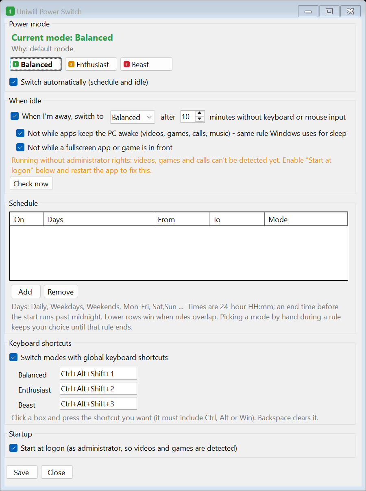

# Uniwill Power Switch

A small, open-source replacement for the power-mode part of **Eluktronics Control Center** (and other
Uniwill-based "Control Center" apps). Switch between **Balanced**, **Enthusiast** and **Beast** from:

- a **notification-area (tray) icon**,
- **global keyboard shortcuts** (default `Ctrl+Alt+Shift+1` / `2` / `3`, configurable),
- a **command line** (`uwpower set beast`),
- a **schedule** (e.g. Beast on weekday evenings), and
- an **idle rule** (drop to Balanced when you walk away, restore when you're back) that uses the same
  signal Windows uses to decide whether it may sleep, so watching a video or playing a game doesn't
  count as being away.



> Not affiliated with Eluktronics or Uniwill. Use at your own risk.

## How it works

The modes are not Windows power plans. They are applied by **GCUService**, a background service that
ships with the laptop's drivers (`C:\Program Files\OEM\...\UniwillService`). It sets the CPU power
limits, GPU power (TGP / Dynamic Boost) and fan tables through the firmware.

The Control Center app doesn't touch the hardware itself. It sends small JSON commands to that
service through a local MQTT broker (`GCUBridge.exe`, port 13688):

| Mode        | Control Center's internal name | Command published to `Fan/Control`        |
|-------------|--------------------------------|-------------------------------------------|
| Balanced    | Office                         | `{"Action":"OPERATING_OFFICE_MODE"}`      |
| Enthusiast  | Gaming                         | `{"Action":"OPERATING_GAMING_MODE"}`      |
| Beast       | Turbo                          | `{"Action":"OPERATING_TURBO_MODE"}`       |

The service confirms on `Tray/Status` (`{"OperatingMode":"0|1|2"}`) and answers
`{"Action":"GETSTATUS"}` with the full profile on `Fan/Status`. This app sends the same commands, so
the service applies exactly the same settings as clicking the buttons in Control Center, including
your customized per-mode profiles. Changes made in Control Center or with the Fn hotkey are noticed
and treated as manual choices.

The broker only accepts the client IDs and logins compiled into `GCUBridge.exe`. This app uses the
slot reserved for the overclocking tool, which nothing on a stock install connects with. You can
change it in `config.json` (`broker` section).

### Requirements

- A Uniwill-based laptop with Control Center's **GCUService** and **GCUBridge** services installed
  (tested on an Eluktronics Prometheus XVII, AMD + NVIDIA). The Control Center *app* itself is not
  needed once this is running.
- Windows 10/11 and the [.NET 8 Desktop Runtime](https://dotnet.microsoft.com/download/dotnet/8.0).

## Install

```powershell
./build.ps1            # needs the .NET 8 SDK; outputs to .\dist
```

Copy `dist` somewhere permanent (e.g. `C:\Program Files\UwPower`), run `UwPowerTray.exe`, open
**Settings** and tick **Start at logon**. That creates a Task Scheduler task that starts the tray app
with administrator rights at logon (one UAC prompt now, none later). Administrator rights are only
needed to read other apps' power requests (see below).

## Command line

```text
uwpower status                         current mode, CPU/GPU limits, automation state
uwpower set balanced|enthusiast|beast  (aliases: office, gaming, turbo)
uwpower auto on|off                    pause/resume schedule + idle switching

uwpower idle                           show idle settings
uwpower idle set --minutes 15 --mode balanced [--enabled on|off]
                 [--power-requests on|off] [--fullscreen on|off]
uwpower idle check                     what currently counts as activity
uwpower idle ignore add "Realtek"      ignore power requests containing a string

uwpower schedule                       list rules
uwpower schedule add --days Weekdays --from 18:00 --to 23:30 --mode beast
uwpower schedule remove|enable|disable <id>
uwpower schedule clear

uwpower hotkeys                        show keyboard shortcuts
uwpower hotkeys set --beast Ctrl+Alt+Shift+F12 [--balanced none] [--enabled on|off]

uwpower autostart enable|disable|status
```

## Keyboard shortcuts

While the tray app is running, `Ctrl+Alt+Shift+1`, `2` and `3` switch to Balanced, Enthusiast and
Beast from anywhere, and a small popup confirms the switch. Change or turn them off under
**Settings > Keyboard shortcuts** (click a box and press the new combination; Backspace clears it) or
with `uwpower hotkeys set`. Shortcuts must include Ctrl, Alt or Win. If another app already owns a
combination, Settings says so.

While the tray app is running, the CLI sends commands through it over a named pipe, because the broker
allows only one connection per client ID. When it isn't running, the CLI talks to the service directly.

## Rules

1. **Automation paused**: nothing switches automatically.
2. **Idle**: the idle mode (default Balanced). Your previous mode comes back as soon as you're active.
3. **Inside a schedule window**: that rule's mode. If several rules overlap, the lowest one in the
   list wins. Picking a mode by hand during a window keeps your choice until the window ends.
   An end time earlier than the start (22:00-06:00) runs past midnight.
4. **Otherwise**: the default mode, which is the last mode you picked by hand outside a window.

### Idle detection

You're considered away when **both** are true:

- no keyboard, mouse or touch input for the configured time (`GetLastInputInfo`), and
- nothing is keeping the PC awake:
  - **Windows power requests** (`DISPLAY`, `SYSTEM`, `AWAYMODE`). These are what video players,
    browsers playing video, games, calls and audio streams register so that Windows doesn't sleep or
    turn off the screen. Reading them (`powercfg /requests`) requires administrator rights; without
    them, the app falls back to input plus the fullscreen check.
  - **A fullscreen app or game in front** (`SHQueryUserNotificationState`), for games that don't
    register a power request. This can be turned off.

Some drivers hold a request permanently (e.g. an audio driver while any app keeps a stream open). Run
`uwpower idle check` to see what's blocking, and `uwpower idle ignore add <text>` to ignore it.

## Files

- Settings: `%APPDATA%\UwPower\config.json`
- Log: `%APPDATA%\UwPower\uwpower.log` (every mode switch with the reason)

## Security note

On the tested laptop, `GCUBridge` listens on **all network interfaces** (port 13688), Windows Firewall
has an inbound *allow* rule for it, and its logins are hard-coded. Anything on your network that can
reach that port may be able to change fan and power settings. Only local connections are needed, and
loopback traffic isn't filtered by the firewall, so disabling that inbound rule is safe:

```powershell
Get-NetFirewallRule -DisplayName GCUBridge | Disable-NetFirewallRule   # elevated PowerShell
```

## Development

```powershell
dotnet build
dotnet test
src/UwPower.Tray/bin/Debug/net8.0-windows/UwPowerTray.exe --screenshot docs/settings.png
```

- `src/UwPower.Core`: MQTT client, Control Center protocol, schedule/idle logic, config, IPC
- `src/UwPower.Cli`: `uwpower.exe`
- `src/UwPower.Tray`: `UwPowerTray.exe` (WinForms tray app + settings window)
- `tests/UwPower.Tests`: unit tests (xUnit)

## License

MIT
